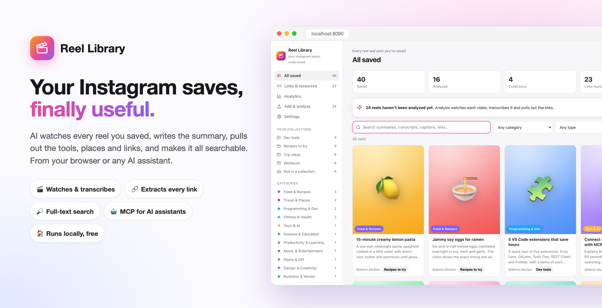
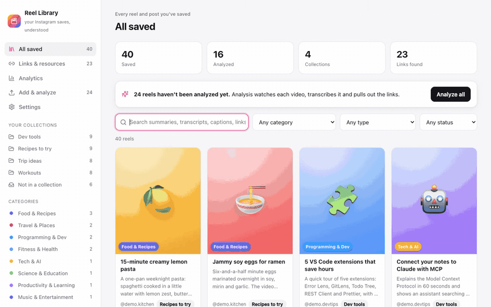
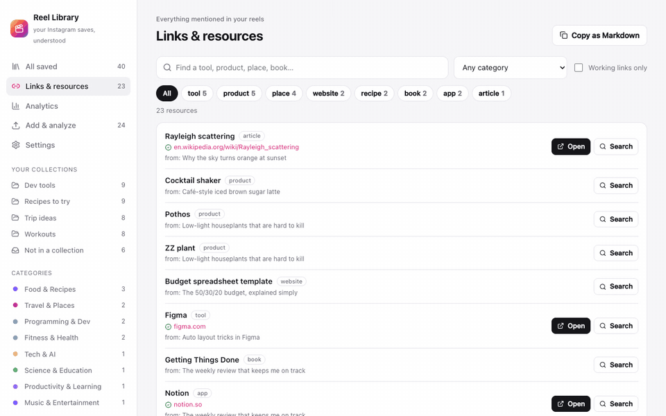
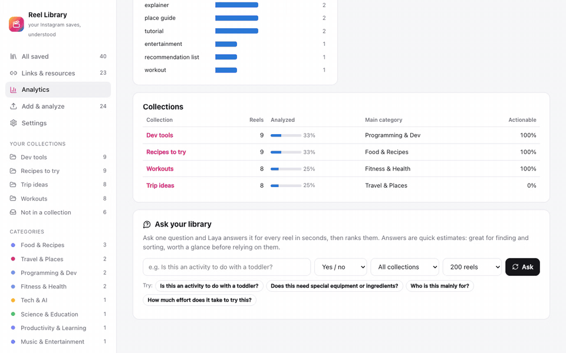
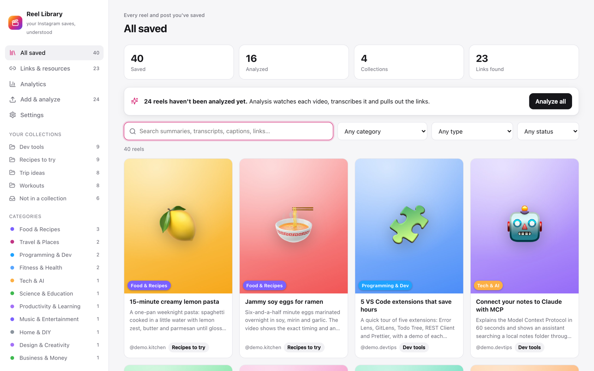
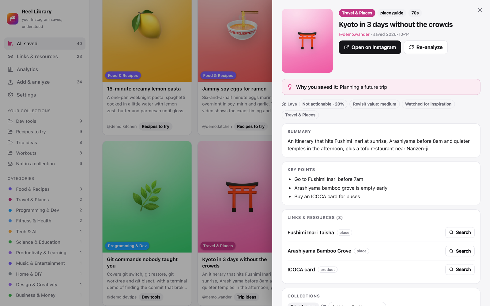
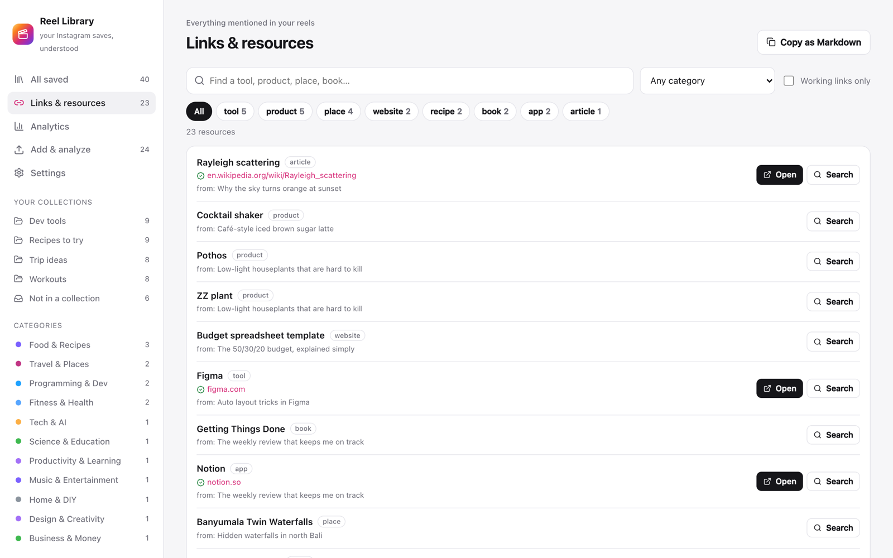
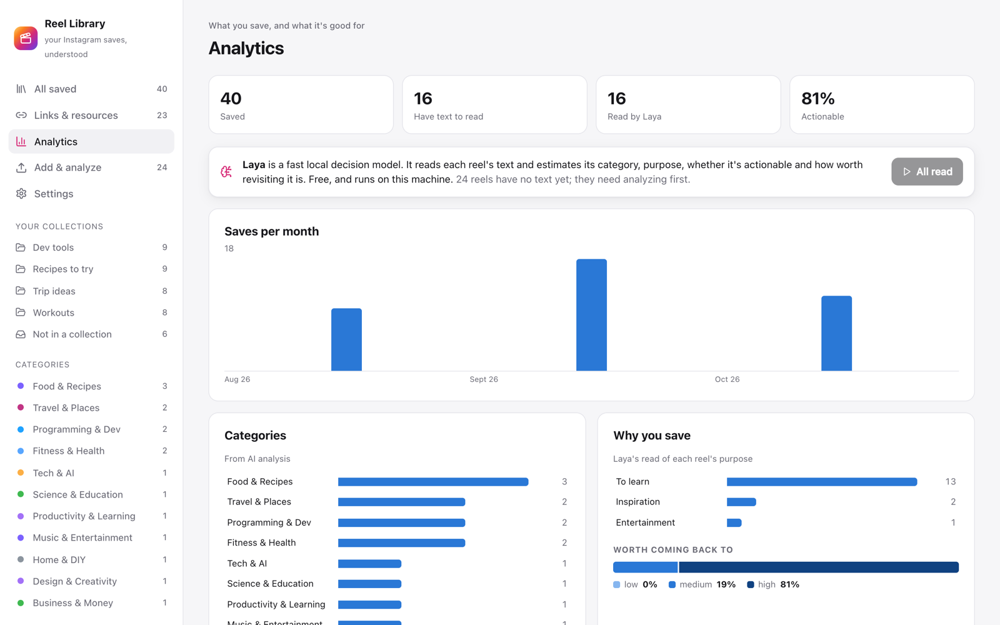
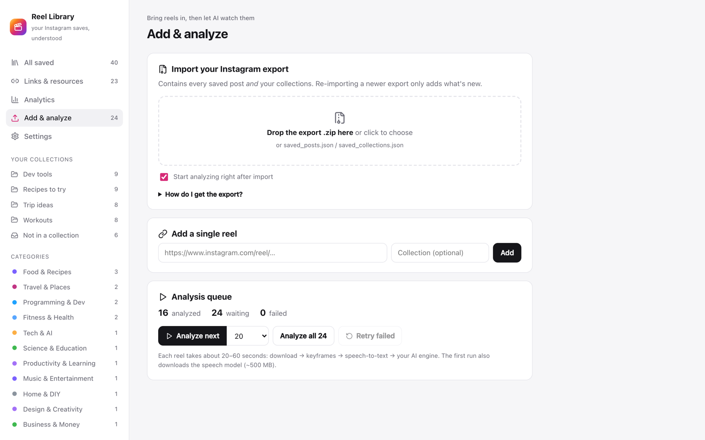
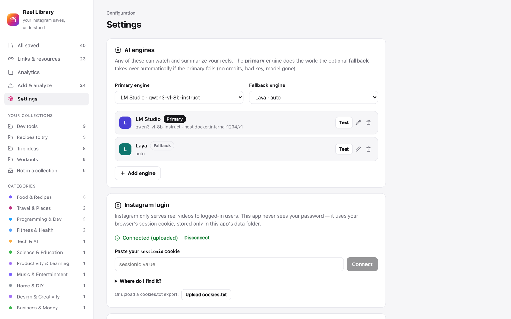

<p align="center">
  
</p>

# Reel Library (instamcp)

[](LICENSE)


**You saved hundreds of reels "for later". Later never came.** Reel Library watches them for you:
it transcribes each one, writes a summary, pulls out every tool, place, product and link, and makes the
whole collection searchable from a clean web app or from any AI assistant.

> **Unofficial, personal-use tool.** Not affiliated with, endorsed by or sponsored by Meta or Instagram.
> It works on reels *you* saved, using *your own* login. Automated downloading may conflict with
> Instagram's Terms of Use: you are responsible for how you use it. Respect creators' rights and
> don't redistribute downloaded content.

Turn your **Instagram saved reels** into a searchable, summarized, organized library, with a web
app to browse it and an **MCP server** so any AI assistant can use it in chat. The analysis runs on
**the AI engine of your choice**: Claude, OpenAI, Google Gemini, OpenRouter, Groq, a free local model
through Ollama or LM Studio, or any OpenAI-compatible endpoint, with automatic fallback between them.

For every saved reel it:

1. **Downloads the video** using your Instagram login.
2. **Watches it**: samples keyframes and **transcribes the speech** locally (faster-whisper).
3. **Understands it** with your chosen AI engine (vision + transcript + caption + the names of *your* saved collections):
   title, summary, key points, category, content type, topics, tags, on-screen text, and *why you
   probably saved it*.
4. **Extracts links & resources**: every tool, app, product, book, place, recipe, repo or site mentioned
   in the caption, spoken aloud or shown on screen. URLs are checked, guessed URLs that don't resolve are
   dropped, and every resource gets a search link.
5. Organizes everything by **your Instagram collections** and by AI-assigned **categories**, with
   full-text search over all of it.
6. **Reads every reel with [Laya](https://github.com/NandhaKishorM/laya)**, a fast local decision model,
   to add signals (actionable? worth revisiting? why you saved it) that drive the **Analytics** page.
   You can also **ask any question across your whole library**, e.g. "Is this an activity to do with a
   toddler?", and get the reels ranked by the answer in seconds.

## See it in action

**Search everything you saved, then open a reel for its summary, key points and links**



**Every tool, place and product mentioned across your reels, in one list**



**Ask one question across your whole library and get the reels ranked by the answer**



## Screenshots

| | |
|---|---|
| <br>**Library**: every saved reel, by collection and category | <br>**Reel detail**: why you saved it, summary, key points, links |
| <br>**Links & resources**: tools, places, books and sites, checked and searchable | <br>**Analytics**: what you save, and what it's good for |
| <br>**Add & analyze**: import your Instagram export, then analyze in batches | <br>**Settings**: pick any AI engine, local or cloud, with automatic fallback |

<sub>Screenshots use a made-up demo library.</sub>

```
                        ┌──────────────── Docker container (port 8090) ────────────────┐
 Instagram export.zip ─►│ Import ─► SQLite + full-text index ◄─ Analysis worker         │
                        │                 ▲        │             yt-dlp → ffmpeg frames │
 Browser  ─────────────►│  React UI ──► REST API    │             whisper → AI engine   │
 AI assistant (MCP) ───►│  /mcp (MCP over HTTP) ────┘                                   │
                        └──────────────────────────────────────────────────────────────┘
                                         volume: /data (db, thumbnails, settings, models)
```

## Run it with Docker (recommended)

On Windows, see [windows/README-WINDOWS.md](windows/README-WINDOWS.md) for a step-by-step guide and
one-click start script.


Requires Docker Desktop. Download the source (or the latest [release](https://github.com/ic3w4r/reel-library/releases/latest)), then:

```bash
cd reel-library
docker compose up -d
```

This pulls the ready-made image (`ghcr.io/ic3w4r/reel-library`, for Intel/AMD and Apple Silicon), a
1-2 GB download the first time. Open **http://localhost:8090**. To use another port:
`INSTAMCP_PORT=9000 docker compose up -d`. To build from source instead: `docker compose up -d --build`.

Then, in the app:

1. **Settings → AI engines:** pick a provider, paste its API key (local models need none), choose a model
   (*Fetch models* lists what your key can use), and click *Test*. Optionally add a second engine as the
   **fallback**.
2. **Settings → Instagram login:** paste your `sessionid` cookie (the page shows where to find it) or
   upload a `cookies.txt`. Instagram only serves reel videos to logged-in users.
3. **Add & analyze:** drop in your Instagram data export zip (how to get it is below) and leave
   *Start analyzing right after import* ticked. Progress shows in the sidebar.
4. **All saved:** browse by collection or category, search everything, and click a reel for its summary,
   key points, links, and transcript. **Links & resources** lists every link across all reels and can
   copy them as Markdown.

Everything is stored in the `instamcp-data` Docker volume, so it survives restarts and rebuilds.

| | |
|---|---|
| Stop | `docker compose down` |
| Update to the latest release | `docker compose pull && docker compose up -d` |
| Run your own code changes | `docker compose up -d --build` |
| Logs | `docker compose logs -f` |
| Back up your data | `docker run --rm -v instamcp_instamcp-data:/data -v "$PWD":/out alpine tar czf /out/instamcp-backup.tgz -C /data .` |
| Delete all data | `docker compose down -v` |

The port is bound to `127.0.0.1` only. The app has no login of its own and stores your API keys, so
don't expose it to a network without putting authentication in front of it.

### Getting your Instagram export

Instagram → Settings → **Accounts Center** → **Your information and permissions** → **Download your
information** → choose your account → **Some of your information** → tick **Saved** → download to
device, format **JSON**, date range **All time**. Instagram emails you when it's ready. Re-importing a
newer export later only adds new reels.

You can also add single reels by URL on the *Add & analyze* page.

## AI engines

Settings → **AI engines** holds any number of engines. The **primary** analyzes every reel; if it fails
because of the account or setup (bad key, no credits or quota, unknown model, server unreachable), the
**fallback** takes over for that reel automatically. If every engine is unusable, the queue pauses with
the reason instead of marking your reels failed.

| Engine | Type | Key | Notes |
|---|---|---|---|
| Claude (Anthropic) | native API | `ANTHROPIC_API_KEY` | Strongest understanding of video frames; effort setting |
| OpenAI | OpenAI-compatible | `OPENAI_API_KEY` | |
| Google Gemini | OpenAI-compatible | `GEMINI_API_KEY` | Uses Gemini's OpenAI-compatible endpoint |
| OpenRouter | OpenAI-compatible | `OPENROUTER_API_KEY` | One key for hundreds of models |
| Groq | OpenAI-compatible | `GROQ_API_KEY` | Very fast |
| Ollama | OpenAI-compatible, local | none | Free and private, e.g. `ollama pull qwen2.5vl:7b` |
| LM Studio | OpenAI-compatible, local | none | Free and private; load a vision model |
| Custom | OpenAI-compatible | optional | vLLM, LocalAI, Azure/other gateways… set the base URL |
| Laya | local decision model | none | Free and offline. Files reels (category, type, signals) from caption + speech but writes no summaries; a good **fallback** or backlog filer |

- Pre-filled model names are suggestions. Use **Fetch models** to pick from what your key can access, and
  prefer a model that accepts images, since it then sees the video frames.
- The OpenAI-compatible adapter adapts to each endpoint: if strict JSON schemas aren't supported it falls
  back to JSON mode, then to prompt-only JSON. If the model can't take images it sends the transcript and
  caption only. Output from any model is normalized to the same categories, types and link kinds.
- Local servers from Docker: presets point at `host.docker.internal`, which reaches Ollama or LM Studio
  running on your Mac.
- API keys set as environment variables (see `docker-compose.yml`) are picked up by the matching engine
  when you don't type one in the UI.

## Analytics and Laya decisions

[Laya](https://github.com/NandhaKishorM/laya) is a non-generative decision model: given text and a typed
question it answers in one forward pass, with no text generation and so nothing to parse or
hallucinate. It answers as `choice` (pick a label), `score` (a level on a scale) or yes/no (a
probability). It runs locally, in 100+ languages.

- **Signals.** Each reel with text (an AI summary, a caption or speech) gets category, content type,
  purpose (learn / entertain / inspire / shop), *actionable* and *revisit value*. These are computed
  automatically after each analysis (toggle in Settings), or in bulk with *Read N reels* on the
  Analytics page.
- **Analytics page.** Saves per month, categories, why you save, kinds of reels, how much is worth
  revisiting, and a per-collection table.
- **Ask your library.** Ask a yes/no, pick-one or scale question across up to 2,000 reels, then filter
  by answer and open any reel. Also available to AI assistants as the `ask_reels` MCP tool.
- **Which checkpoint answers.** Choice questions run on `laya-multilingual`, which classified a mixed
  test set best. Yes/no and scale questions go through Laya's router: English text to the English
  checkpoint, which separates yes from no more cleanly, and other languages to the multilingual one.
- **Limits.** Laya's base checkpoints are quick estimators, not experts; its authors note they are
  weak on complex decisions without fine-tuning. Use the answers to find and sort, and check before
  relying on one. A reel needs text first, so un-analyzed reels from the export are skipped until
  they're analyzed.
- **Size.** Laya brings PyTorch (CPU build in Docker). Its checkpoints (~1–2 GB) download into the
  data volume the first time it runs; the first run takes about a minute, then it's under a second
  per reel on a Mac and a few seconds on CPU.

## Connect an AI assistant (MCP)

The container serves MCP over HTTP at `http://localhost:8090/mcp`.

**Claude Code**

```bash
claude mcp add --transport http --scope user instagram http://localhost:8090/mcp
```

Other MCP clients (Cursor, VS Code, …) take a config like
`{"mcpServers": {"instagram": {"url": "http://localhost:8090/mcp"}}}`. Settings shows both, ready to copy.

Then ask things like:

- "Give me an overview of my saved reels by collection."
- "Find that reel about the garlic pasta and give me the steps."
- "List every AI tool I've saved, with links."
- "Make a 4-week workout plan from my Fitness saves."

### MCP surface

| Tool | What it does |
|---|---|
| `library_overview` | Collections (with counts and top categories), categories, content types, top tags/creators, status counts |
| `search_reels` | Ranked full-text search over titles, summaries, captions, transcripts, on-screen text, tags, links, collection names |
| `list_reels` | Browse by collection / category / content type / creator / tag / status |
| `get_reel` | Everything about one reel (id or URL): key points, transcript, why it was saved, all links |
| `find_links` | Aggregated links/resources across reels, filterable by kind, category, collection, query |
| `analyze_reels` | Download, transcribe and summarize pending reels (or re-analyze specific ones) |
| `import_instagram_export` | Import an export zip/folder/json (path as seen by the server) |
| `add_reel` | Add a single URL |
| `move_to_collection` | File a reel into a local collection |
| `sync_saved_from_instagram` | Optional live sync via instaloader (local install only) |
| `library_analytics` | Saves per month, category/type/purpose mix, actionable and revisit stats, per-collection stats |
| `ask_reels` | Ask a yes/no, choice or scale question across reels with Laya; reels ranked by the answer |

Resources: `instagram://overview`, `instagram://reel/{id}`, `instagram://collection/{name}`.
Prompts: `digest_collection(collection)`, `plan_from_saved(goal)`.

## Running without Docker (development)

Requires [uv](https://docs.astral.sh/uv/), ffmpeg and Node 20+ (`brew install uv ffmpeg node`).

```bash
uv sync --extra decisions      # drop --extra decisions to skip Laya / PyTorch
(cd web && npm install && npm run build)
uv run instamcp web            # UI + API + MCP on http://127.0.0.1:8080
```

For UI work, run `uv run instamcp web` plus `cd web && npm run dev` (Vite on :5173, proxied to :8080).

Other commands: `instamcp serve` (MCP over stdio for Claude Desktop/Code), `instamcp import <zip>`,
`instamcp add <url>`, `instamcp analyze --limit 50`, `instamcp stats`. Outside Docker, the default data
folder is `~/.instamcp`, and `INSTAMCP_COOKIES_FROM_BROWSER=chrome` can borrow your Chrome login instead
of a pasted cookie.

## Configuration

Most settings can be changed on the Settings page; these environment variables set the defaults.

| Variable | Default | |
|---|---|---|
| `ANTHROPIC_API_KEY`, `OPENAI_API_KEY`, `GEMINI_API_KEY`, `OPENROUTER_API_KEY`, `GROQ_API_KEY` | – | Provider keys (or type them in Settings → AI engines) |
| `INSTAMCP_DATA_DIR` | `~/.instamcp` (`/data` in Docker) | Database, thumbnails, settings, uploads |
| `INSTAMCP_FRAMES` | `8` | Keyframes sent per reel |
| `INSTAMCP_WHISPER_MODEL` | `small` | `tiny` / `base` / `small` / `medium` / `large-v3` |
| `INSTAMCP_COOKIES_FROM_BROWSER` | – | Local only: browser to borrow the Instagram login from |
| `INSTAMCP_COOKIES_FILE` | – | A Netscape-format cookies.txt |
| `INSTAMCP_KEEP_MEDIA` | `0` | `1` keeps downloaded videos |
| `INSTAMCP_VERIFY_LINKS` | `1` | Check extracted URLs for reachability |
| `INSTAMCP_AUTO_SIGNALS` | `1` | Add Laya signals after each analysis |

## Notes

- Each reel takes about 20–60 seconds. Cost depends on the engine: very roughly 10¢ per reel on Claude
  Opus 5.5 at medium effort, much less on smaller or "flash"-class models, and nothing on a local model.
  The first analysis also downloads the speech model (~500 MB, kept in the data volume).
- Claude requests on current models also opt into Anthropic's server-side refusal fallbacks, so a rare
  model decline is retried instead of failing the reel.
- Photo/carousel posts with no downloadable video are analyzed from the caption when one is known,
  otherwise marked failed with the reason (retry from *Add & analyze*).
- Everything stays on your machine except the call to your AI engine (frames + transcript + caption) and
  link checks. With a local engine (Ollama / LM Studio), nothing leaves your machine except link checks.

## Contributing

Ideas, bug reports and pull requests are welcome. See [CONTRIBUTING.md](CONTRIBUTING.md) for how to
run it locally and send changes, and [SECURITY.md](SECURITY.md) to report a vulnerability privately.

## License

[Apache License 2.0](LICENSE). See [NOTICE](NOTICE) for third-party components. Instagram is a
trademark of Meta Platforms, Inc.
